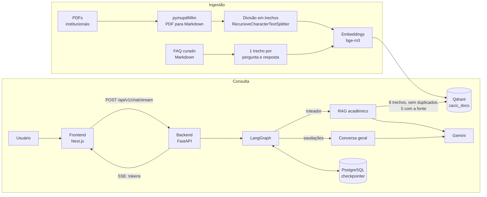

# Assistente Virtual CACIC

Chatbot baseado em **RAG (Retrieval-Augmented Generation)** que responde dúvidas de estudantes de Ciência da Computação da UESC sobre regulamentos, matriz curricular, horas complementares e de extensão, TCC, estágio, matrícula e processos acadêmicos, usando exclusivamente documentos institucionais como fonte. As respostas são entregues em tempo real, token a token, via Server-Sent Events (SSE).

**No ar:** https://assistentecacic.me/

## Funcionalidades

- Ingestão de documentos: PDFs institucionais são convertidos em Markdown, divididos em trechos, vetorizados e indexados no Qdrant. Conteúdo curado (como o FAQ do CACIC) entra por um fluxo próprio, com uma pergunta e resposta por trecho.
- Adição incremental: novos documentos entram na base sem recriar a coleção.
- Busca semântica com embeddings `BAAI/bge-m3`, com remoção de trechos duplicados e identificação da fonte de cada trecho.
- Respostas ancoradas no contexto recuperado, com temperatura 0 e uma resposta padrão quando a informação não consta nos documentos (reduz alucinações).
- Agente modelado como grafo de estados no LangGraph, com roteamento entre RAG acadêmico e conversa geral.
- Memória de conversa por sessão, persistida em PostgreSQL (`AsyncPostgresSaver`).
- Streaming de respostas com SSE (FastAPI) e consumo com `fetch` + `ReadableStream` (Next.js).
- Conjunto de avaliação com perguntas reais dos alunos e script que mede a taxa de acerto.
- Feedback útil/não útil por resposta e registro de perguntas sem resposta, para decisões sobre o FAQ virem de dados reais.
- Limites de uso (por conversa, por IP e teto diário) para proteger a cota grátis do Gemini.
- Toda a solução containerizada com Docker Compose.

## Arquitetura



**Ingestão:** o script `backend/etl_pipeline.py` faz a carga inicial: lê os PDFs da pasta `data/`, converte cada um em Markdown com `pymupdf4llm` (preservando tabelas e estrutura), divide o texto em trechos, gera os embeddings com o `bge-m3` e grava os vetores na coleção `cacic_docs` do Qdrant. O `backend/adicionar_docs.py` acrescenta (ou remove) documentos depois, sem recriar a coleção, e também indexa arquivos Markdown curados, como o `docs/FAQ_CACIC.md`.

**Fluxo de uma pergunta:**

1. O frontend envia `thread_id` e `message` para `POST /api/v1/chat/stream`.
2. O grafo decide o ramo: saudações curtas vão para a conversa geral; o restante passa pelo RAG.
3. No RAG, a pergunta é vetorizada e os 8 trechos mais similares são buscados no Qdrant. Trechos repetidos (o mesmo regulamento pode estar em mais de um PDF) são removidos, e os 5 melhores entram no prompt, cada um identificado por `[Fonte: nome do documento]`. O prompt obriga o modelo a responder só com esse contexto.
4. O Gemini gera a resposta, que o backend repassa como eventos SSE (cada token como uma string JSON), encerrando com `[DONE]`.
5. O histórico da sessão é salvo no PostgreSQL pelo checkpointer do LangGraph.

## Stack

| Camada | Tecnologias |
| --- | --- |
| Backend | Python, FastAPI, Uvicorn |
| Agente | LangGraph, LangChain |
| LLM | Google Gemini (`gemini-3.5-flash-lite`) via `langchain-google-genai` |
| Ingestão | `pymupdf4llm`, `langchain-text-splitters` |
| Busca vetorial | Qdrant, `BAAI/bge-m3` (`langchain-huggingface`) |
| Memória | PostgreSQL, `AsyncPostgresSaver`, `psycopg_pool` |
| Frontend | Next.js (App Router), React, TypeScript, Tailwind CSS |
| Qualidade | pytest, Ruff, GitHub Actions |
| Infraestrutura | Docker, Docker Compose |

## Estrutura do projeto

```text
cacic_assistant_v2/
├── docker-compose.yml
├── docker-compose.prod.yml   # produção: usa os Dockerfiles multi-stage + Caddy, sem bind mount de código
├── Caddyfile                 # proxy reverso de produção: /api/* -> backend, resto -> frontend (mesmo host)
├── .env.example
├── .github/workflows/ci.yml  # CI: lint (Ruff), testes (pytest) e checagem de sintaxe
├── docs/
│   ├── FAQ_CACIC.md          # FAQ curado: um par pergunta/resposta por seção
│   └── DEPLOY.md             # roteiro de deploy (Ubuntu/x86_64, testado na Hetzner Cloud)
├── design/                   # sistema de design do frontend: tokens, componentes e previews HTML
├── backend/
│   ├── Dockerfile
│   ├── main.py               # FastAPI, CORS, /health e o lifespan (modelo, Qdrant, pool, grafo)
│   ├── etl_pipeline.py       # carga inicial: PDFs -> Markdown -> chunks -> Qdrant (recria a coleção)
│   ├── adicionar_docs.py     # adiciona/remove documentos sem recriar a coleção (PDF ou .md curado)
│   ├── curados.py            # divide documentos curados em seções (lógica pura)
│   ├── regulamentos.py       # divide resoluções/editais por artigo/seção antes do chunking (pura)
│   ├── versionamento.py      # hash + manifesto dos documentos indexados (lógica pura)
│   ├── verificar_documentos.py  # relatório só leitura: documentos novos, que mudaram ou foram removidos
│   ├── registro.py           # feedback e perguntas sem resposta, em Postgres (tolerante a falha)
│   ├── limites.py            # limite por IP e teto diário, em Postgres (tolerante a falha)
│   ├── pytest.ini
│   ├── ruff.toml
│   ├── api/
│   │   ├── routes.py         # POST /chat/stream (gerador SSE) e POST /feedback
│   │   ├── schemas.py        # validação do request (ChatRequest, FeedbackRequest)
│   │   ├── sse.py            # formatação dos eventos SSE
│   │   ├── controle_stream.py # decide quando acionar o modelo de reserva (lógica pura)
│   │   └── ip_cliente.py     # extrai o IP do cliente a partir dos headers (lógica pura)
│   ├── agent/
│   │   ├── graph.py          # construir_grafo(): roteador, RAG, conversa geral (fábrica, chamada no lifespan)
│   │   ├── roteamento.py     # regra de roteamento (pura, testável)
│   │   ├── contexto.py       # seleção, deduplicação e rotulagem dos trechos (pura, testável)
│   │   ├── reescrita.py      # reescreve a pergunta de acompanhamento para a busca (pura, testável)
│   │   ├── llm.py            # instância do Gemini (principal e reserva)
│   │   └── prompts.py        # prompt do RAG
│   ├── eval/
│   │   ├── perguntas.json         # perguntas de desenvolvimento, resposta esperada e fatos que devem aparecer
│   │   ├── perguntas_heldout.json # conjunto separado, nunca usado para ajustar prompt/busca/FAQ
│   │   ├── avaliar.py             # roda as perguntas no backend e calcula a taxa de acerto (--rodadas N)
│   │   ├── classificar_erros.py   # classifica falhas do held-out em busca, resposta ou documento
│   │   ├── diagnosticar.py        # mostra os trechos que a busca devolve para uma pergunta
│   │   └── historico/             # resultados guardados como evidência (linha de base e final)
│   └── tests/                # roteamento, SSE, validação, contexto, reescrita, limites e documentos curados
├── data_pipeline/            # módulos em evolução (chunking semântico, reranking)
│   ├── pyproject.toml
│   ├── uv.lock
│   ├── extractor.py
│   ├── chunker.py            # SemanticChunker
│   ├── embedder.py
│   ├── vector_store.py
│   └── reranker.py
├── scripts/
│   └── listar_modelos.py     # utilitário: lista os modelos disponíveis na API do Gemini
└── frontend/
    └── app/
        ├── layout.tsx
        ├── tokens.css         # tokens de design (cor, tipografia, espaçamento)
        ├── cacic.css          # componentes visuais do design system
        └── page.tsx          # interface de chat e parser SSE
```

## Como executar

### Pré-requisitos

- Docker e Docker Compose v2
- [uv](https://docs.astral.sh/uv/) para instalar as dependências e executar a ingestão
- Uma chave da API do Google Gemini
- Pelo menos 8 GB de RAM livres: o modelo de embeddings `bge-m3` ocupa alguns GB na memória, e o backend e a ingestão o carregam

### 1. Configurar as variáveis de ambiente

```bash
cp .env.example .env
```

Edite o `.env` com a sua chave do Gemini e uma senha para o PostgreSQL (use apenas letras e números, pois ela entra na URL de conexão).

### 2. Subir os serviços

```bash
docker compose up --build
```

Na primeira execução, o modelo `bge-m3` é baixado do Hugging Face, então o backend pode levar alguns minutos para ficar pronto. Acompanhe com `docker compose logs -f backend` e espere por `Application startup complete`. Em máquinas com pouca memória, suba em duas etapas: `docker compose up -d postgres qdrant backend` e, quando o backend estiver pronto, `docker compose up -d frontend`.

### 3. Indexar os documentos

Coloque os PDFs institucionais na pasta `backend/data/` (ela não faz parte do repositório) e, com o Qdrant no ar (acessível em `localhost:6333`), execute a carga inicial a partir da pasta `backend/`:

```bash
cd backend
uv sync
mkdir -p data                # copie os PDFs para cá
uv run python etl_pipeline.py
```

O script usa a variável `QDRANT_URL` (padrão `http://localhost:6333`) e grava os vetores na coleção `cacic_docs`. **Atenção:** ele apaga e recria a coleção; use-o só na carga inicial.

Para incluir documentos depois, sem reprocessar os demais:

```bash
uv run python adicionar_docs.py data/novo_documento.pdf   # PDF
uv run python adicionar_docs.py ../docs/FAQ_CACIC.md      # Markdown curado
uv run python adicionar_docs.py --remover "data/antigo.pdf"
```

Reexecutar o comando no mesmo arquivo substitui os trechos antigos dele (a identificação da fonte é `data/<nome do arquivo>`). Para atualizar um documento, mantenha o nome do arquivo. O backend não precisa ser reiniciado: ele consulta o Qdrant a cada pergunta.

#### Conteúdo curado (FAQ)

O `docs/FAQ_CACIC.md` reúne as perguntas mais frequentes dos estudantes, com um par de pergunta e resposta por seção, separadas por linhas `---`. Cada seção vira um único trecho de busca, o que evita misturar assuntos. Isso importa porque, em um FAQ comum, o trecho que lista só as perguntas ganha da resposta na busca por similaridade, e o assistente recusa a pergunta mesmo com a resposta na base. Como o FAQ é a fonte mais atual, o prompt manda preferi-lo quando um regulamento mais antigo o contradiz (por exemplo, o regimento descreve a segunda chamada como requerimento ao Departamento, e o procedimento atual é pelo processo SEI).

### 4. Acessar

- Interface: http://localhost:3000
- API: http://localhost:8000/docs

## Testes

```bash
cd backend
uv run --with pytest pytest -q
```

Os testes cobrem a regra de roteamento, a formatação dos eventos SSE (incluindo a reconstrução da resposta a partir do fluxo), a validação do request, a seleção e rotulagem dos trechos e a divisão dos documentos curados (incluindo a verificação de que cada seção do FAQ tem pergunta e resposta). Não precisam de chave do Gemini, banco nem modelos. O CI roda o lint (Ruff) e os testes a cada push.

## Avaliação

O assistente é avaliado com um conjunto de perguntas reais dos estudantes (`backend/eval/perguntas.json`). Cada pergunta tem a resposta esperada e os fatos que a resposta precisa conter; há também perguntas fora do escopo, em que o correto é recusar. Um item pode ter um campo opcional `conversa`, com mensagens anteriores enviadas na mesma conversa antes da pergunta avaliada — simula uma pergunta de acompanhamento (ex.: "e para a matriz 2012?").

```bash
# com o backend no ar
python3 backend/eval/avaliar.py
```

O script espera o backend ficar saudável (`/health`), faz cada pergunta em uma conversa nova, repete em falhas transitórias (como o erro 503 do Gemini) e informa a taxa de acerto por categoria. As respostas completas ficam em `backend/eval/resultados-<data>.json` para leitura, porque o critério automático (presença dos fatos-chave) é só uma triagem. Para ver o que a busca devolve para uma pergunta, use `uv run python eval/diagnosticar.py "pergunta"`.

### Resultados

| Etapa | Acertos | Taxa |
| --- | --- | --- |
| Linha de base: documentos incompletos, 3 trechos na busca | 6/26 | 23% |
| Regimento e legislação indexados, critério baseado nos documentos oficiais | 16/26 | 62% |
| Busca com 8 trechos, sem duplicados e com a fonte de cada trecho | 19/26 | 73% |
| FAQ reorganizado em pares de pergunta e resposta | 24/26 | 92% |
| Ajuste de uma seção do FAQ e do critério de uma pergunta | 25/26 | 96% |

As perguntas fora do escopo foram recusadas em todas as rodadas, e nenhuma resposta inventada foi identificada. Cada etapa corrigiu uma causa diferente: critério de avaliação, documentos que faltavam na base, busca e formato do conteúdo curado.

**Limite desta medição:** o conjunto de 26 perguntas foi escrito a partir do FAQ, que agora faz parte da base. Ele mede bem se a busca encontra o que está indexado, mas **não** estima o desempenho com perguntas novas dos alunos. O critério de avaliação também foi ajustado entre algumas etapas, conforme os documentos oficiais e o FAQ foram sendo reconciliados. O próximo passo é um segundo conjunto, com perguntas que não saíram do FAQ.

**Perguntas de acompanhamento:** a busca usava só a última mensagem da conversa, então uma pergunta como "e para a matriz 2012?" perdia o assunto. Oito casos de acompanhamento (campo `conversa`) foram adicionados ao conjunto para medir isso: sem reescrever a pergunta antes da busca, 5/8 passavam; com a reescrita (histórico da conversa vira uma pergunta independente, só para a busca — ver "Decisões técnicas"), 7/8 passam, sem regressão nos 26 originais. O custo é uma chamada extra ao Gemini por pergunta de acompanhamento (~1,5-2s).

### Conjunto de avaliação separado (held-out)

Os 26 (+ 8 de acompanhamento) itens acima são um **conjunto de desenvolvimento**: foram escritos a partir do FAQ e já guiaram ajustes de prompt, busca e conteúdo, então uma boa nota ali não garante o mesmo desempenho com perguntas novas. `backend/eval/perguntas_heldout.json` é um segundo conjunto — perguntas que o sistema nunca viu, escritas pelo Bruno ou por alunos reais (sem dados pessoais) — que **nunca** deve ser usado para ajustar prompt, FAQ, busca ou `K_BUSCA`/`K_CONTEXTO`. Qualquer item que motive uma correção é marcado como `"queimado": true` (continua no arquivo, como histórico, mas deixa de contar como resultado limpo na próxima rodada oficial).

Schema igual ao de `perguntas.json`, mais:

| Campo | Descrição |
| --- | --- |
| `fonte_gabarito` | De onde vem a resposta certa, em texto legível (ex.: `"Regimento Geral da UESC (2006), Art. 101"`), não o caminho do arquivo. `classificar_erros.py` cruza automaticamente usando o mesmo nome "legível" dos rótulos `[Fonte: X]` do prompt (`agent.contexto.nome_fonte`). |
| `origem` | `"aluno"` ou `"bruno"`. |
| `queimado` | Booleano; `false` até o item motivar uma correção. |

`backend/eval/perguntas_heldout.exemplo.json` documenta os campos com um exemplo de cada tipo (resposta, recusa, acompanhamento) — não é lido por nenhum script. `backend/eval/validar_heldout.py` confere o esquema, ids únicos e que nenhuma pergunta é repetida ou quase igual a uma do conjunto de desenvolvimento:

```bash
uv run python eval/validar_heldout.py
```

Para rodar:

```bash
uv run python eval/avaliar.py --arquivo eval/perguntas_heldout.json --rodadas 3
```

**Primeira rodada oficial (2026-11-15, sem nenhum ajuste de prompt/busca/FAQ/K antes dela): 13/20 (65%, IC 95% Wilson [43%, 82%])** — bem abaixo dos 96% do conjunto de desenvolvimento, confirmando que esse número era otimista. Das 7 falhas, `eval/classificar_erros.py` e a revisão manual (PDFs de editais/calendário confirmados corretos pelo Bruno) encontraram 4 de busca/seleção (tipo a) e 3 de prompt/resposta mesmo com o contexto certo (tipo b) — maioria em busca/seleção, prioridade da próxima etapa (ver `docs/ROADMAP.md`, Etapa 3, para o detalhe de cada falha).

`--rodadas N` repete a mesma lista de perguntas N vezes e relata a variação (média e desvio padrão dos acertos) entre rodadas. O relatório mostra o **intervalo de confiança de Wilson** ao lado da taxa simples — com 15 a 20 itens esse intervalo é largo (ex.: 7/8 acertos dá algo como 53%-98%), e é por isso: uma taxa pontual sozinha, com tão poucos itens, não diz muito sobre o desempenho real. Para entender cada erro, `eval/classificar_erros.py <resultado.json>` separa, para cada falha, se (a) a busca não achou o trecho certo, (b) o trecho estava no contexto e o modelo respondeu errado, ou (c) o documento nem está indexado — (d) gabarito errado nunca é automático, o script só reúne os dados para você decidir.

## Variáveis de ambiente

| Variável | Descrição |
| --- | --- |
| `GOOGLE_API_KEY` | Chave da API do Google Gemini |
| `POSTGRES_PASSWORD` | Senha do PostgreSQL (usada pelo banco e montada na `DATABASE_URL`) |
| `GEMINI_MODEL` | Opcional. Modelo principal do Gemini (padrão: `gemini-3.5-flash-lite`) |
| `GEMINI_FALLBACK_MODEL` | Opcional. Modelo de reserva, acionado quando o principal falha (padrão: nenhum, sem reserva) |
| `GEMINI_MAX_RETRIES` | Opcional. Tentativas do modelo principal antes de desistir (padrão: `1` com reserva configurada, `3` sem reserva) |
| `GEMINI_MAX_OUTPUT_TOKENS` | Opcional. Limite de tokens da resposta (padrão: `4096`) |
| `RAG_K_BUSCA` | Opcional. Trechos buscados no Qdrant (padrão: `8`) |
| `RAG_K_CONTEXTO` | Opcional. Trechos enviados ao modelo, depois de remover duplicados (padrão: `5`) |
| `LIMITE_MENSAGENS_POR_THREAD` | Opcional. Mensagens (pergunta + resposta) permitidas numa mesma conversa, para proteger a cota grátis do Gemini (padrão: `15`) |
| `LIMITE_MENSAGENS_POR_IP_POR_DIA` | Opcional. Mensagens aceitas por IP por dia (padrão: `50`) |
| `TETO_MENSAGENS_POR_DIA` | Opcional. Teto global de mensagens aceitas por dia, somando todos os IPs (padrão: `400`) |
| `API_DOCS_HABILITADOS` | Opcional. Liga/desliga `/docs`, `/redoc` e `/openapi.json` (padrão: `true`; desligado em produção) |
| `LOG_LEVEL` | Opcional. Nível de log do backend (padrão: `INFO`) |
| `CORS_ORIGINS` | Opcional. Origens permitidas, separadas por vírgula (padrão: `http://localhost:3000`) |
| `NEXT_PUBLIC_API_URL` | Opcional, no frontend. URL base da API (padrão: `http://localhost:8000`) |

`DATABASE_URL` e `QDRANT_URL` são definidas pelo `docker-compose.yml` para a rede interna dos contêineres.

## API

`POST /api/v1/chat/stream`

```json
{ "thread_id": "3f2a9c1e-5b7d-4e8a-9c21-7d4e5f6a8b90", "message": "Quantas horas de ACC preciso cumprir?" }
```

- `thread_id`: identificador da sessão (de 8 a 64 caracteres: letras, números, `_` e `-`). O frontend gera um UUID por navegador, e cada `thread_id` tem o próprio histórico.
- `message`: de 1 a 2000 caracteres.

A resposta é um fluxo `text/event-stream`. Cada evento tem o formato `data: "<token como string JSON>"`, e o fim do fluxo é sinalizado por `data: [DONE]`. Se ocorrer uma falha durante a geração, o servidor envia um evento `event: error` com uma mensagem genérica (o detalhe técnico fica só no log) e encerra com `[DONE]`. Se a conversa já atingiu `LIMITE_MENSAGENS_POR_THREAD`, o servidor envia `event: limite` em vez de gerar uma resposta. Se o IP já atingiu `LIMITE_MENSAGENS_POR_IP_POR_DIA` ou o dia já atingiu `TETO_MENSAGENS_POR_DIA`, o servidor envia `event: bloqueado`.

Também há `GET /health`, que responde `{"status": "ok"}`.

## Decisões técnicas

- **Extração com `pymupdf4llm`:** converte PDFs em Markdown preservando tabelas e estrutura, o que melhora a qualidade dos trechos indexados em documentos regulatórios.
- **Async de ponta a ponta:** o `AsyncConnectionPool` é criado dentro do event loop do Uvicorn, e o grafo usa `astream_events` (LangGraph v2).
- **Tokens como JSON no SSE:** serializar cada token com `json.dumps` evita ambiguidade com quebras de linha e caracteres especiais.
- **Parser SSE com buffer no cliente:** só eventos completos são processados, e o `TextDecoder` roda em modo `stream`, o que evita perda de texto e corrupção de acentos quando um evento chega fragmentado.
- **Prompt de ancoragem:** o modelo só responde com o contexto recuperado e tem uma resposta padrão de "rota de fuga" quando a informação não existe nos documentos. Cada trecho chega identificado pela fonte, e em caso de conflito entre documentos o FAQ prevalece.
- **Busca com margem:** a busca traz 8 trechos, remove duplicados (mesmo texto indexado a partir de PDFs diferentes) e envia os 5 melhores. Com apenas 3 trechos, a passagem certa muitas vezes ficava em quarto lugar e o assistente recusava a pergunta.
- **Conteúdo curado em pares de pergunta e resposta:** cada par é um trecho de busca; a pergunta e a resposta nunca ficam separadas.
- **Roteamento conservador:** apenas saudações curtas vão para a conversa geral; o resto passa pelo RAG. Cada decisão de roteamento e os trechos recuperados (com a fonte) são registrados em log.
- **Lógica pura e testável:** roteamento, formatação SSE, validação, seleção de contexto e divisão de documentos ficam em módulos sem dependência de modelos, o que permite testes rápidos e CI sem chave de API.
- **Avaliação guiada por dados:** mudanças na busca e nos documentos são medidas com o conjunto de perguntas antes de serem mantidas.
- **Sessão por navegador:** o frontend gera um UUID guardado no `localStorage`; o botão "Nova conversa" cria outro.
- **Erros sem vazamento:** exceções internas vão para o log; o cliente recebe só uma mensagem genérica.
- **Reescrita da pergunta de busca:** antes de buscar no Qdrant, uma pergunta de acompanhamento ("e para a matriz 2012?") é reescrita numa versão independente usando o histórico da conversa — só para a busca; o prompt de resposta continua vendo as mensagens originais. Usa um cliente Gemini dedicado (mesmos modelos principal/reserva, saída bem menor), com uma tag própria nos eventos do LangGraph para a rota de SSE não repassar esses tokens ao cliente nem confundir essa chamada interna com uma troca para o modelo de reserva. Qualquer falha ou saída vazia cai para a pergunta original.
- **Limite por conversa:** com orçamento zero, o limite de `LIMITE_MENSAGENS_POR_THREAD` não é sobre custo, é sobre não esgotar a cota grátis do Gemini. A rota confere o tamanho da conversa com `app_grafo.aget_state(config)` (lê o checkpoint sem rodar nenhum nó do grafo) antes de gerar qualquer resposta; ao atingir o limite, envia o evento SSE `limite` sem nenhuma chamada ao Gemini. O frontend mostra "Nova conversa" nesse caso (não "Tentar novamente", que só repetiria a mesma pergunta) e desabilita a caixa de texto até o aluno clicar.
- **Limite por IP e teto diário global:** o limite por conversa é fácil de burlar (o botão "Nova conversa" gera outro `thread_id`), e a cota do Gemini (free tier) é compartilhada por toda a chave de API, não por aluno. `backend/limites.py` guarda, por dia, quantas mensagens cada IP mandou e o total aceito (uma linha-sentinela `__global__` na mesma tabela, incrementada com o mesmo `UPSERT ... RETURNING` atômico usado pelo IP — sem `SELECT SUM` sujeito a corrida). O IP vem de `X-Forwarded-For` em produção (confiável porque o Caddy é o único ponto de entrada e não repassa o header que o cliente tentar forjar) ou da conexão direta em desenvolvimento. O contador global conta em dobro uma pergunta de acompanhamento (custa uma chamada extra ao Gemini, para reescrever a busca) — erra para o lado seguro, nunca subconta chamadas reais. Falha ao acessar o Postgres deixa passar (o checkpointer já depende dele; se estiver fora do ar, o chat já não funciona de qualquer jeito). Excedendo qualquer um dos dois limites, o servidor envia `event: bloqueado`; o frontend desabilita a caixa de texto sem oferecer nenhum botão de ação (nem "tentar de novo" nem "nova conversa" ajudam nesse caso).
- **Headers de segurança e superfície mínima:** auditoria de segurança (2026-11-19, ver `docs/ROADMAP.md`) confirmou proteção real contra SQL injection, XSS, falsificação de IP e acesso direto a portas internas — mas identificou três pontos de hardening, todos corrigidos. O `Caddyfile` agora envia `Content-Security-Policy`, `Strict-Transport-Security`, `X-Content-Type-Options` e `X-Frame-Options`; os headers `Server` (uvicorn, via `--no-server-header`) e `X-Powered-By` (Next.js, via `poweredByHeader: false`) deixaram de anunciar a stack; e `/docs`/`/redoc`/`/openapi.json` do FastAPI, que só não vazavam por não estarem sob `/api/*` no roteamento do Caddy, agora são desligados explicitamente em produção por `API_DOCS_HABILITADOS=false`, em vez de depender desse acaso.
- **PyTorch sem CUDA:** `sentence-transformers` (usado pelo `HuggingFaceEmbeddings`/bge-m3) traz o `torch` como dependência transitiva, e por padrão o PyPI resolve a build com suporte a GPU — ~4GB de pacotes `nvidia-*`/`triton` que nunca são usados num servidor sem GPU, e que já causaram falha de build em produção por falta de espaço em disco. `pyproject.toml` declara `torch` como dependência direta (necessário para `[tool.uv.sources]` valer — não tem efeito em dependências transitivas) apontando para o índice `https://download.pytorch.org/whl/cpu`. Reduz o `.venv` de ~5,9GB para ~1,5GB, sem nenhuma mudança de comportamento (o projeto sempre rodou em CPU).
- **Deploy e HTTPS sem configuração manual de certificado:** produção roda em `docker-compose.prod.yml` (Dockerfiles multi-stage, sem bind mount de código) atrás do Caddy, que também resolve CORS ao servir frontend e backend (`/api/*`) no mesmo host. Usar um nome de domínio (em vez de `:80`) no `Caddyfile` já é suficiente para o Caddy provisionar e renovar o certificado Let's Encrypt sozinho, por HTTP-01 — nenhuma outra configuração de TLS é necessária. Hospedado hoje numa VPS Hetzner Cloud; o `docs/DEPLOY.md` não depende de provedor ou arquitetura específicos (testado em Ubuntu/x86_64, mas vale para qualquer VM Linux com Docker).

## Limitações conhecidas

- **503 do Gemini (mitigado):** a API pode responder `503 UNAVAILABLE` em momentos de alta demanda. Antes do primeiro token, o backend falha rápido e troca para o `GEMINI_FALLBACK_MODEL`, sem o aluno perceber. Se a troca acontecer depois de tokens já enviados, a rota emite um evento SSE `reset` e o frontend descarta o texto parcial antes de mostrar a resposta da reserva. Se tudo falhar, o frontend mostra uma mensagem amigável com o botão "Tentar novamente" (que reenvia a última pergunta; o histórico salvo no servidor pode manter a pergunta repetida, o que não afeta a resposta).
- Documentos oficiais mais antigos podem contradizer práticas atuais; a base só reflete o que está indexado, e o FAQ é a referência para procedimentos recentes.
- A busca é apenas semântica (densa), e a pontuação de similaridade entre trechos relevantes e irrelevantes é próxima, o que pede um reranker em perguntas mais difíceis. Busca híbrida (BM25 + densa) foi testada e revertida: piorou a avaliação sem corrigir os casos-alvo, porque a pergunta do aluno costuma não repetir o vocabulário do trecho certo (ex.: pergunta diz "documento", resposta diz "laudo médico") — o mesmo descompasso que o BM25 também não resolve.
- O conjunto de avaliação é pequeno e foi derivado do FAQ (ver a seção de Avaliação).
- Em pelo menos um caso de acompanhamento (`fu-estagio-disciplina`), a busca encontrou o trecho certo em 1º lugar e ainda assim o modelo recusou: um problema de prompt/geração de resposta, não de recuperação.

## Próximos passos

- Reranker ou expansão de consulta (HyDE/multi-query), para o descompasso de vocabulário entre pergunta e resposta que a divisão por artigo não resolveu — uma primeira tentativa de busca híbrida (BM25 + densa) piorou a avaliação sem corrigir os casos-alvo (ver "Limitações conhecidas").
- Número da página do PDF junto da fonte nas respostas (hoje só o nome do documento).
- Integrar ou consolidar os módulos de `data_pipeline/` (chunking semântico, reranker).

## Autor

**Bruno Cardoso de Jesus** · Ciência da Computação, UESC
