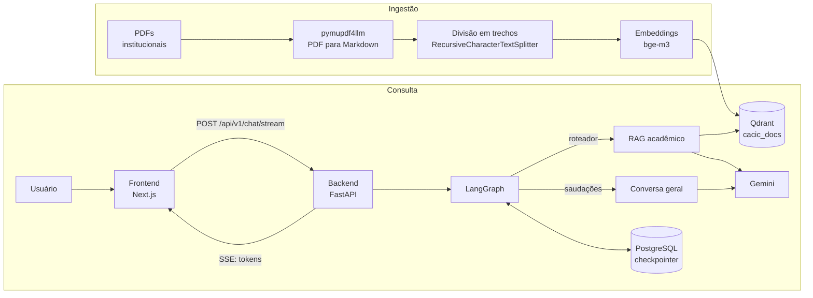

# Assistente Virtual CACIC

Chatbot baseado em **RAG (Retrieval-Augmented Generation)** que responde dúvidas de estudantes de Ciência da Computação da UESC sobre regulamentos, matriz curricular, ACC, TCC, estágio e processos acadêmicos, usando exclusivamente documentos institucionais como fonte. As respostas são entregues em tempo real, token a token, via Server-Sent Events (SSE).

## Funcionalidades

- Pipeline de ingestão (ETL) que converte PDFs institucionais em Markdown, divide em trechos, vetoriza e indexa no Qdrant.
- Busca semântica com embeddings `BAAI/bge-m3`.
- Respostas ancoradas no contexto recuperado, com temperatura 0 e uma resposta padrão quando a informação não consta nos documentos (reduz alucinações).
- Agente modelado como grafo de estados no LangGraph, com roteamento entre RAG acadêmico e conversa geral.
- Memória de conversa por sessão, persistida em PostgreSQL (`AsyncPostgresSaver`).
- Streaming de respostas com SSE (FastAPI) e consumo com `fetch` + `ReadableStream` (Next.js).
- Toda a solução containerizada com Docker Compose.

## Arquitetura



**Ingestão:** o script `backend/etl_pipeline.py` lê os PDFs da pasta `data/`, converte cada um em Markdown com `pymupdf4llm` (preservando tabelas e estrutura), divide o texto em trechos, gera os embeddings com o `bge-m3` e grava os vetores na coleção `cacic_docs` do Qdrant.

**Fluxo de uma pergunta:**

1. O frontend envia `thread_id` e `message` para `POST /api/v1/chat/stream`.
2. O grafo decide o ramo: saudações curtas vão para a conversa geral; o restante passa pelo RAG.
3. No RAG, a pergunta é vetorizada, os trechos mais similares são buscados no Qdrant e montados no prompt, que obriga o modelo a responder só com esse contexto.
4. O Gemini gera a resposta, que o backend repassa como eventos SSE (cada token como uma string JSON), encerrando com `[DONE]`.
5. O histórico da sessão é salvo no PostgreSQL pelo checkpointer do LangGraph.

## Stack

| Camada | Tecnologias |
| --- | --- |
| Backend | Python, FastAPI, Uvicorn |
| Agente | LangGraph, LangChain |
| LLM | Google Gemini (`gemini-3.5-flash-lite`) via `langchain-google-genai` |
| Ingestão | `pymupdf4llm`, `langchain-text-splitters` |
| Busca vetorial | Qdrant, `BAAI/bge-m3` (`langchain-huggingface`) |
| Memória | PostgreSQL, `AsyncPostgresSaver`, `psycopg_pool` |
| Frontend | Next.js (App Router), React, TypeScript, Tailwind CSS |
| Infraestrutura | Docker, Docker Compose |

## Estrutura do projeto

```text
cacic_assistant_v2/
├── docker-compose.yml
├── .env.example
├── .github/workflows/ci.yml # CI: lint (Ruff), testes (pytest) e checagem de sintaxe
├── backend/
│   ├── Dockerfile
│   ├── main.py              # FastAPI, CORS e /health
│   ├── etl_pipeline.py      # ingestão: PDFs -> Markdown -> chunks -> Qdrant
│   ├── pytest.ini
│   ├── ruff.toml
│   ├── api/
│   │   ├── routes.py        # POST /chat/stream (gerador SSE)
│   │   ├── schemas.py       # validação do request (ChatRequest)
│   │   └── sse.py           # formatação dos eventos SSE
│   ├── agent/
│   │   ├── graph.py         # StateGraph: roteador, RAG, conversa geral
│   │   ├── roteamento.py    # regra de roteamento (pura, testável)
│   │   ├── llm.py           # Instância do Gemini
│   │   └── prompts.py       # Prompt do RAG
│   └── tests/               # testes de roteamento, SSE e validação do request
├── data_pipeline/           # módulos em evolução (chunking semântico, reranking)
│   ├── pyproject.toml
│   ├── uv.lock
│   ├── extractor.py
│   ├── chunker.py           # SemanticChunker
│   ├── embedder.py
│   ├── vector_store.py
│   └── reranker.py
├── scripts/
│   └── listar_modelos.py    # utilitário: lista os modelos disponíveis na API do Gemini
└── frontend/
    └── app/
        ├── layout.tsx
        └── page.tsx         # Interface de chat e parser SSE
```

## Como executar

### Pré-requisitos

- Docker e Docker Compose v2
- [uv](https://docs.astral.sh/uv/) para instalar as dependências e executar a ingestão
- Uma chave da API do Google Gemini
- Pelo menos 8 GB de RAM livres: o modelo de embeddings `bge-m3` ocupa alguns GB na memória

### 1. Configurar as variáveis de ambiente

```bash
cp .env.example .env
```

Edite o `.env` com a sua chave do Gemini e uma senha para o PostgreSQL (use apenas letras e números, pois ela entra na URL de conexão).

### 2. Subir os serviços

```bash
docker compose up --build
```

Na primeira execução, o modelo `bge-m3` é baixado do Hugging Face, então o backend pode levar alguns minutos para ficar pronto. Acompanhe com `docker compose logs -f backend`.

### 3. Indexar os documentos

Coloque os PDFs institucionais na pasta `backend/data/` (ela não faz parte do repositório) e, com o Qdrant no ar (acessível em `localhost:6333`), execute a ingestão a partir da pasta `backend/`:

```bash
cd backend
uv sync
mkdir -p data                # copie os PDFs para cá
uv run python etl_pipeline.py
```

O script usa a variável `QDRANT_URL` (padrão `http://localhost:6333`) e grava os vetores na coleção `cacic_docs`.

### 4. Acessar

- Interface: http://localhost:3000
- API: http://localhost:8000/docs

## Testes

```bash
cd backend
uv run --with pytest pytest -q
```

Os testes cobrem a regra de roteamento, a formatação dos eventos SSE (incluindo a reconstrução da resposta a partir do fluxo) e a validação do request. Não precisam de chave do Gemini, banco nem modelos. O CI roda o lint (Ruff) e os testes a cada push.

## Variáveis de ambiente

| Variável | Descrição |
| --- | --- |
| `GOOGLE_API_KEY` | Chave da API do Google Gemini |
| `POSTGRES_PASSWORD` | Senha do PostgreSQL (usada pelo banco e montada na `DATABASE_URL`) |
| `GEMINI_MODEL` | Opcional. Modelo do Gemini (padrão: `gemini-3.5-flash-lite`) |
| `GEMINI_MAX_OUTPUT_TOKENS` | Opcional. Limite de tokens da resposta (padrão: `4096`) |
| `LOG_LEVEL` | Opcional. Nível de log do backend (padrão: `INFO`) |
| `CORS_ORIGINS` | Opcional. Origens permitidas, separadas por vírgula (padrão: `http://localhost:3000`) |
| `NEXT_PUBLIC_API_URL` | Opcional, no frontend. URL base da API (padrão: `http://localhost:8000`) |

`DATABASE_URL` e `QDRANT_URL` são definidas pelo `docker-compose.yml` para a rede interna dos contêineres.

## API

`POST /api/v1/chat/stream`

```json
{ "thread_id": "3f2a9c1e-5b7d-4e8a-9c21-7d4e5f6a8b90", "message": "Quantas horas de ACC preciso cumprir?" }
```

- `thread_id`: identificador da sessão (de 8 a 64 caracteres: letras, números, `_` e `-`). O frontend gera um UUID por navegador, e cada `thread_id` tem o próprio histórico.
- `message`: de 1 a 2000 caracteres.

A resposta é um fluxo `text/event-stream`. Cada evento tem o formato `data: "<token como string JSON>"`, e o fim do fluxo é sinalizado por `data: [DONE]`. Se ocorrer uma falha durante a geração, o servidor envia um evento `event: error` com uma mensagem genérica (o detalhe técnico fica só no log) e encerra com `[DONE]`.

Também há `GET /health`, que responde `{"status": "ok"}`.

## Decisões técnicas

- **Extração com `pymupdf4llm`:** converte PDFs em Markdown preservando tabelas e estrutura, o que melhora a qualidade dos trechos indexados em documentos regulatórios.
- **Async de ponta a ponta:** o `AsyncConnectionPool` é criado dentro do event loop do Uvicorn, e o grafo usa `astream_events` (LangGraph v2).
- **Tokens como JSON no SSE:** serializar cada token com `json.dumps` evita ambiguidade com quebras de linha e caracteres especiais.
- **Parser SSE com buffer no cliente:** só eventos completos são processados, e o `TextDecoder` roda em modo `stream`, o que evita perda de texto e corrupção de acentos quando um evento chega fragmentado.
- **Prompt de ancoragem:** o modelo só responde com o contexto recuperado e tem uma resposta padrão de "rota de fuga" quando a informação não existe nos documentos.
- **Roteamento conservador:** apenas saudações curtas vão para a conversa geral; o resto passa pelo RAG. Cada decisão de roteamento e os trechos recuperados são registrados em log.
- **Sessão por navegador:** o frontend gera um UUID guardado no `localStorage`; o botão "Nova conversa" cria outro.
- **Erros sem vazamento:** exceções internas vão para o log; o cliente recebe só uma mensagem genérica.

## Próximos passos

- Integrar ao fluxo principal os módulos de `data_pipeline/`: chunking semântico (`SemanticChunker`) na ingestão e reranker na consulta, para descartar contexto irrelevante.
- Reescrever a pergunta com o histórico antes da busca vetorial.
- Exibir as fontes (documento e página) nas respostas.
- Conjunto de avaliação com perguntas reais dos alunos.
- Pool de conexões e grafo compilados uma única vez no `lifespan` do FastAPI.

## Autor

**Bruno Cardoso de Jesus** · Ciência da Computação, UESC
